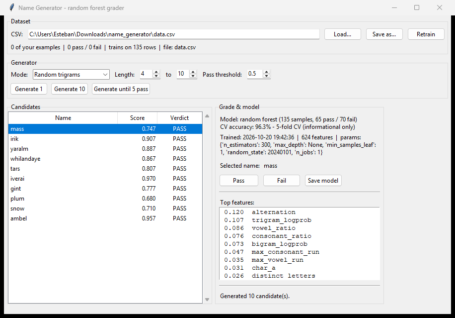
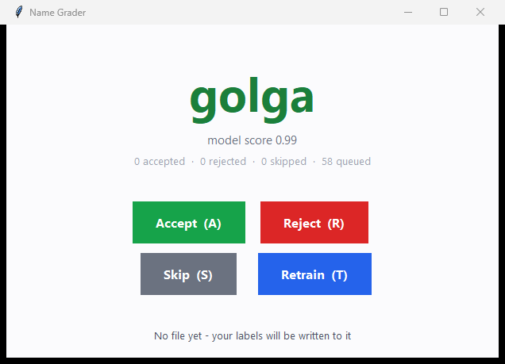

# Name Generator (random-forest graded)

A name generator whose output is graded **pass / deny** by a random forest
classifier.  You generate candidate names, mark the ones you like, and the
model learns your taste over time.



---

## Install

```powershell
.\venv\Scripts\Activate.ps1
pip install -r requirements.txt
```

The only direct dependency is **scikit-learn** (numpy, scipy, joblib and
threadpoolctl come with it).  The GUI uses `tkinter`, which ships with
CPython on Windows - nothing extra to install.

## Run

```powershell
python main.py                    # launch the full GUI
python main.py --simple           # launch the ultra-simplified grader
python main.py --selftest         # headless end-to-end check
python main.py --data my.csv      # use a different dataset file
python main.py --corpus words.txt # generate from your own word list
```

## Two interfaces

Both interfaces share the same model, generator and CSV, so a grade recorded
in one is immediately visible in the other.

| | `python main.py` | `python main.py --simple` |
|---|---|---|
| Purpose | Explore and inspect many candidates at once | Grade one name at a time, fast |
| Shows | A table of 1-10 candidates with scores | One large name |
| Actions | Pass / Fail, threshold slider, 3 generation modes | Accept / Reject / Skip / Retrain |
| Keys | mouse | `A` `R` `S` `T` (plus `Space`/`Return` for accept) |

### The simple grader



One name fills the screen.  Only names the model **passed** are shown, so
Accept and Reject are always a meaningful override of the model's opinion
(the name's score is printed underneath).  Names are ordered best-first, so
the strongest candidates come up first.

| Key | Button | Action |
|---|---|---|
| `A` | Accept | record the name as a pass, then show the next |
| `R` | Reject | record the name as a fail, then show the next |
| `S` | Skip | record nothing, show the next |
| `T` | Retrain | full refit of the model, then regenerate candidates |
| `Space` / `Return` | Accept | alias for `A` |
| `Q` / `Esc` | - | quit |

Skip is for names you are not sure about - it moves on without writing
anything, so those names never enter the training set.

## Files

| File | Role |
|---|---|
| `main.py` | Entry point, CLI flags, and the `--selftest` harness. |
| `dataset.py` | CSV reading/writing, tolerant label parsing, appending grades. |
| `model.py` | Feature extraction + `RandomForestClassifier` + training. |
| `generator.py` | Trigram name generation (random / markov / accepted). |
| `ui.py` | The full tkinter interface. |
| `ui_simple.py` | The ultra-simplified one-name-at-a-time grader. |
| `seed_data.py` | Built-in seed corpus and default word list. |
| `data.csv` | **Your** labels. Created on first grade. |
| `requirements.txt` | Dependencies. |

---

## How it works

### 1. Generation (`generator.py`)

Three modes, all built on character trigrams:

* **Random trigrams** - the classic approach.  A trigram is sampled from a
  background English corpus; each following trigram must *continue* the
  previous one (it has to start with the last two characters already
  emitted), so the result is a chain of real letter sequences rather than
  unrelated chunks jammed together.  This produces names like `calet`,
  `mina`, `tide`, `wana`.
* **Markov (from passes)** - the same trigram machinery, but the chain is
  fitted to the names *you* marked as pass, so generation is biased toward
  your taste.
* **Generate until accepted** - generates in a loop and keeps only the
  candidates the classifier passes.  This is where the random forest does
  real work rather than just labelling a list.

### 2. Grading (`model.py`)

Each name is turned into a feature vector with two blocks that are stacked
horizontally:

* **Structural features** (13 dense floats): length, vowel and consonant
  ratios, longest vowel/consonant runs, repeated letters, distinct letters,
  bigram and trigram log-probability under a background model, leading and
  trailing vowel flags, a vowel-consonant alternation score, and a
  has-digit flag.
* **Character n-grams**: a `CountVectorizer` over character 1-3 grams, which
  lets the forest memorise letter sequences that look like the examples you
  marked as good.

Those feed a `RandomForestClassifier` (300 trees).  `score(name)` returns
`P(pass)`, which the UI shows as a 0-1 score and compares against the
threshold slider.

### 3. Training is a full refit, and it is deterministic

`model.py` does **one** thing when you retrain: it fits a single
`RandomForestClassifier` on the entire labelled dataset.  There is no
strategy search, no sample weighting, no special handling for the newest
example - it is just one more row.

That is a deliberate choice, and it buys you **reproducibility**:

* The same CSV contents always produce the same model, byte for byte.
* The forest uses a fixed `random_state` and `n_jobs=1`, so tree building
  and vote averaging cannot vary between runs.
* The cross-validation splitter is seeded too, so the reported accuracy is
  stable.

The cross-validated accuracy shown in the UI is **informational only**.  It
never selects a model and never gates a retrain - whether to keep training
is your call, not the code's.  Use it to spot a training set that has gone
stale (for example after grading many examples of one kind).

The seed corpus is added to the training set as a baseline so that a model
trained on only a handful of your grades does not collapse to a single class.
Because training is a plain full refit, those seed rows are treated exactly
like any other row.  **They are never written to your `data.csv`** - that
file contains only labels you gave yourself.

---

## The CSV

Canonical format:

```csv
name,label
alice,1
xkcdzx,0
```

The loader is tolerant, so hand-made files work:

* **Name column**: `name`, `text`, `word`, `label_name`, `example`, `string`,
  `value` - or the first column if no header matches.
* **Label column**: `label`, `target`, `class`, `y`, `is_good`, `result`,
  `verdict` - or the first non-name column.
* **Label values**: `1`/`0`, `pass`/`fail`, `yes`/`no`, `true`/`false`,
  `pos`/`neg`, `good`/`bad`, `accepted`/`rejected`.
* A file with no header row at all is read as (name, label) per line.

Grading a candidate appends a row to the loaded file immediately.

---

## Using the GUI

1. **Generate** - pick a mode and a length range, then hit *Generate 1*,
   *Generate 10*, or *Generate until 5 pass*.
2. **Inspect** - each candidate shows its score and a PASS/FAIL verdict
   against the current threshold.  Double-click a row to grade it.
3. **Grade** - select a row and press **Pass** or **Fail**.  The row is
   appended to your CSV straight away.
4. **Retrain** - press **Retrain** to do a full refit over the whole dataset.
   The status bar reports the new CV accuracy.
5. **Tune** - move the threshold slider to be stricter or more lenient; the
   verdicts update live.  The *Top features* panel shows which signals the
   forest is leaning on.

The **Save model** button writes the trained forest to a `.joblib` file.

---

## Self-test

```powershell
python main.py --selftest
```

Runs seventeen checks with no GUI: CSV round-trip, label normalisation,
training, **retrain determinism** (same data must give identical scores),
class separation, all three generator modes, the accepted-only path, grade
appending, single-class handling, and the simple interface's key bindings
(`A` records a pass, `R` a fail, `S` nothing, `T` retrains, and the CSV on
disk stays in sync with what the app recorded).
